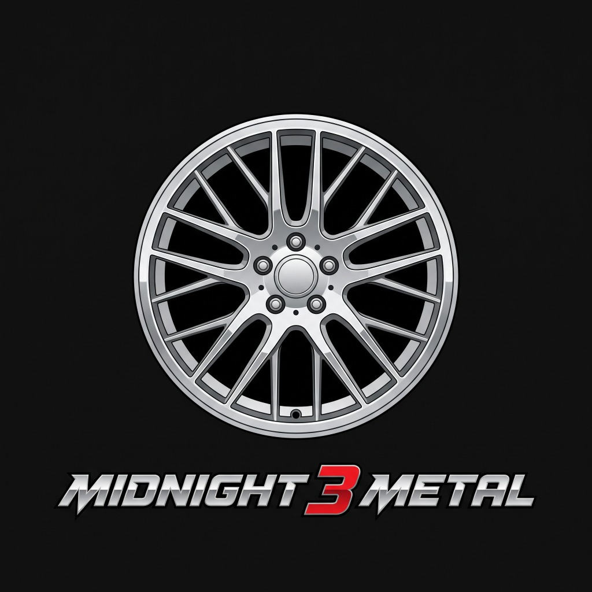

<p align="center">
  
</p>

<h1 align="center">Midnight3Metal</h1>

<p align="center">
  
  
  
  
  <br />
  
  
  
  
  
  
</p>

**Midnight3Metal** is a native **iOS (ARM64 / Metal)** static recompilation port of the original Xbox **Midnight Club 3: DUB Edition Remix**.

Instead of running an x86 emulator or JIT, the original Xbox executable (`default.xbe`) is statically recompiled into portable C++ ahead of time and linked against a native iOS runtime powered by **Apple Metal**, **Audio Queue Services**, and **UIKit** touch/controller input.

> **Disclaimer:** This repository contains **source code, runtime libraries, and build configuration only**. No copyrighted game binaries (`default.xbe`), assets, audio, or Xbox SDK files are included. You must supply your own legally obtained copy of the game.

---

## Features

- **Native Apple Metal Renderer (`sdk/runtime/gpu/metal.mm`)**
  - Translates NV2A fixed-function pipelines, programmable vertex shaders, and Xbox pixel combiners to Metal Shading Language (MSL).
  - Unified offscreen render targets with feedback-copy support, viewport/scissor clipping, masked/sub-rect clears, P8 paletted textures, cube/3D textures, and Bink video decoding.
  - Triple-buffered transient upload ring buffer (`MTLBuffer`), zero-copy tightly-packed vertex layouts, native triangle-strip/index submission, and per-encoder state caching for smooth 50–60 FPS gameplay without lowering visual quality.
- **Xbox DirectSound & XACT Software Mixer (`sdk/runtime/xdk/dsound.cpp`)**
  - Full HLE DirectSound buffer & stream mixer running on Apple Audio Queue Services (`48 kHz` stereo float) with ADPCM/PCM decoding, 3D audio attenuation, mixbins, envelopes, and proper `IDirectSoundStream::FlushEx` / envelope-flush lifecycle handling.
- **Native Mobile Racing Touch Controls, In-Game HUD Editor & Gamepad Support (`sdk/runtime/app/ios_touch_controls.mm`)**
  - **Auto-switching HUD** between **Driving Mode** (analog steering or toggleable left/right arrows, `GAS`, `BRAKE`, `NOS`, `DRIFT`, `SPEC`, `2W`, plus top utility pills `MAP`, `CAM`, `REAR`, `FLASH`, pause, and next track) and **Menu / Garage Mode** (`OK`, `BACK`, `OPTS`, `VIEW`, `TAB`, `ZOOM`, `START`, D-pad).
  - **In-game HUD & Controls Editor (`⚙`)**: drag any button, steering control, or FPS pill to reposition it, resize individual buttons or global HUD scale, adjust HUD opacity, toggle the FPS counter, and save layouts automatically across sessions.
  - Built-in real-time color-coded **FPS counter** pill on the top HUD bar.
  - Supports physical Bluetooth / MFi / Xbox / PlayStation controllers via SDL3.
- **128 MB Guest Memory Mode & Offline XNet Stubs**
  - Allocates a 128 MB guest memory space (expanding the MC3 heap from 47 MB to 111 MB) to prevent out-of-memory crashes when entering the Garage and open-world city.
  - Offline Xbox Live / XNet stubs so the game runs cleanly without Xbox Live services.
- **Automated CI iOS IPA Build (`.github/workflows/ios-build.yml`)**
  - Builds an unsigned Release ARM64 `.ipa` on `macos-15` with Xcode when game recompilation inputs are provided.

---

## Repository Structure

```text
.
├── config/                 # Recompiler configuration & Xbox XDK 5849 symbol maps (game.toml)
├── ios-app/                # iOS UIKit + CAMetalLayer host app (AppDelegate, ViewController, DebugOverlay)
├── ios-game-runtime/       # Lightweight iOS SDK compile-check target for core runtime modules
├── sdk/
│   ├── runtime/
│   │   ├── app/            # iOS native touch HUD (ios_touch_controls.mm) & app lifecycle
│   │   ├── audio/          # Apple AudioQueue backend (audio_apple.mm) & XAudio2 backend
│   │   ├── core/           # Input abstraction, logging, diagnostics
│   │   ├── cpu/            # x86 execution context & static dispatch tables
│   │   ├── gpu/            # NV2A/D3D8 state, vertex assembler, HLSL->MSL translator, Metal backend
│   │   ├── kernel/         # Xbox kernel HLE (threads, timers, DPC/APC, virtual/physical memory, VFS)
│   │   └── xdk/            # DirectSound, XAPI/XInput, XNet/XOnline HLE modules
│   └── xdk/                # XDK 5849 struct layouts and signature definitions
├── src/                    # Game-specific hooks, patches, and career/traffic bridges
├── tools/                  # Repository cleanliness guard & helper scripts
└── .github/workflows/      # GitHub Actions CI workflows for iOS builds
```

---

## Running on iOS

No jailbreak and **no JIT** are required — everything runs natively as ARM64 code on Apple Metal.

1. **Download the `.ipa`** from the [Releases](https://github.com/Prams43/Midnight3Metal/releases/latest) page (or build it yourself via Xcode / the `ios-build.yml` workflow).
2. **Sideload & install** the `.ipa` onto your iPhone or iPad using **AltStore**, **SideStore**, **TrollStore**, **Sideloadly**, or **Xcode**.
3. **Copy your own Xbox game files** into the app's folder:
   - Open the iOS **Files** app → **On My iPhone** (or **On My iPad**) → **`MC3 Remix`** *(or use Finder / iTunes File Sharing on macOS/Windows)*.
   - Copy **`default.xbe`** and all extracted game asset folders from your legally obtained original Xbox copy of *Midnight Club 3: DUB Edition Remix* directly into that folder.
   - *(Note: The `.ipa` does **not** include any game data, textures, audio, or movies — you must provide your own copy.)*
4. **Launch `MC3 Remix`** in landscape orientation:
   - Touch controls automatically switch between **Driving** and **Menu / Garage** modes; use the top bar buttons to switch steering style (`◀▶` / `◎`) or manually toggle `MENU` / `DRIVE` at any time.
   - Connect any Bluetooth / MFi / Xbox / PlayStation controller for native gamepad play.

---

## Development & Repo Hygiene

Before committing changes, run the repository cleanliness check to verify that no game assets, build outputs, or temporary files are tracked:

```bash
python tools/check_repo_clean.py
```

---

## License & Legal

- The iOS port and project code in this repository are licensed under the **GNU General Public License v3.0** — see [LICENSE](LICENSE).
- The modified Xbox XBE Recomp SDK under `sdk/` retains its original **MIT License** — see [sdk/LICENSE](sdk/LICENSE) and [NOTICE.md](NOTICE.md).
- This project is intended for preservation, research, and educational purposes. *Midnight Club 3: DUB Edition Remix* is a trademark of Rockstar Games / Take-Two Interactive. Original Xbox and DirectSound/XACT are trademarks of Microsoft Corporation.
